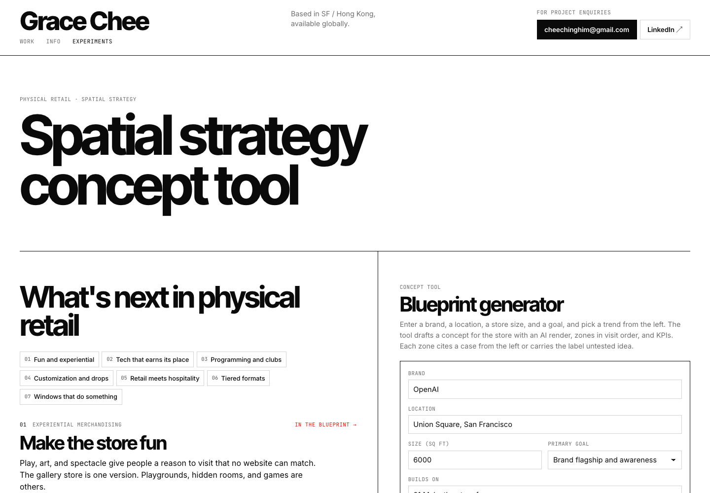
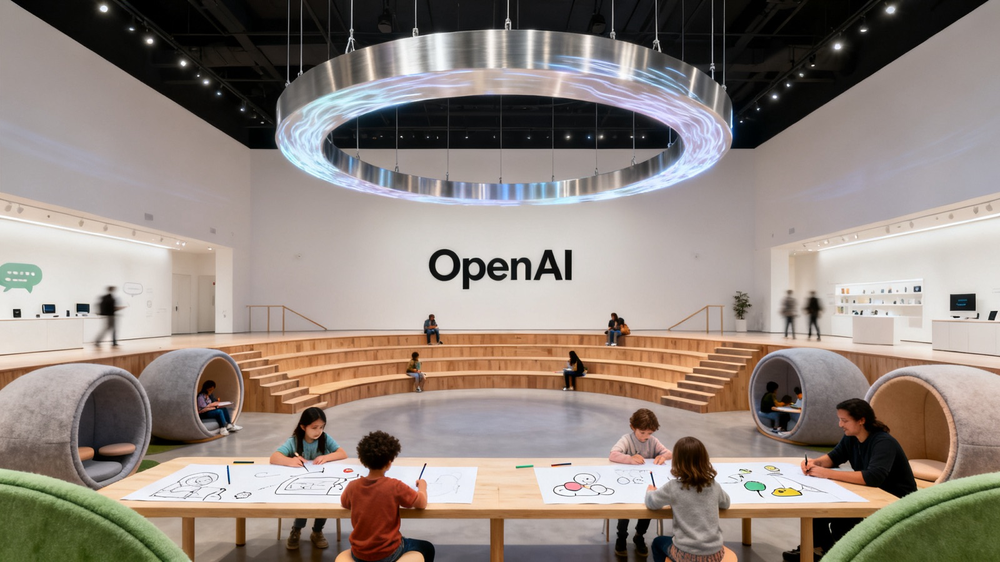

# Spatial Strategy Playbook

Type in a brand, a location, a store size and a goal. Get back a first draft store concept: the insight, a named concept, an AI render of the interior, zones in visit order from the window to the back, and KPIs. Every zone cites a real, published case study, or says plainly that it's an untested idea.

**Live:** [gracechee.com/playbook](https://www.gracechee.com/playbook/) (the generator needs an access code; [email me](mailto:cheechinghim@gmail.com?subject=Playbook%20access%20code) for one)

Built on [fal](https://fal.ai): Claude writes the blueprint through fal's OpenRouter endpoint, and Seedream v4 on fal renders the concept.



## Example output

**OpenAI, Union Square SF, 6,000 sq ft, brand flagship, building on "Make the store fun"**

> OpenAI is known for ChatGPT and sells almost entirely through screens, so this may be its first store. The store must let people talk, draw, and play with the models using their voices and hands, because most visitors have only read about what it does.

Concept: **The Play Lab × OpenAI**, a science museum playground where each exhibit is a game that answers back.



The full blueprint, with 8 zones and their citations, is in [`playbook/example.json`](playbook/example.json).

## Why I built it

I spent four years designing brand activations and retail experiences for Nike, Sephora, Visa and OpenAI, and trained as an architect before that. Most AI strategy tools make things up. This one can only cite what's in [`data/case-studies.json`](data/case-studies.json): 13 measured case studies, 7 of my own projects, industry research, design precedents and store layout principles, each with its source. If nothing supports an idea, the page says so.

## How it stays grounded

1. **The server picks the evidence.** `strategy.mjs` scores every case study against the goal, the chosen trend, the store size and the notes, and sends only the best matches to the model.
2. **The model must cite from that list.** The response is constrained to a strict JSON schema, and every zone carries `evidence_ids`.
3. **The server checks the citations.** Any id that wasn't offered is dropped, each zone's confidence (`proven`, `precedent`, `untested`) is recomputed from what's left, and zone shares are rescaled to 100%.
4. **The render can't be hijacked.** The server writes the image prompt and signs it with an HMAC. `/api/mockup` renders only signed prompts, so it can't be used as a free image generator.

The browser never sends a prompt. It sends form fields, and the server builds everything.

## Files

| Path | What it is |
|---|---|
| `playbook/index.html` | The page: seven retail trends with their evidence, and the generator |
| `playbook/playbook.js` | Renders the evidence, the example and live blueprints |
| `playbook/evidence.mjs` | Turns an evidence id into a citation; shared by the page and the server |
| `playbook/trends.mjs` | The seven trends, their tactics and their render direction |
| `data/case-studies.json` | The evidence base |
| `netlify/functions/strategy.mjs` | `POST /api/strategy`: selects evidence, calls Claude via fal, validates citations |
| `netlify/functions/mockup.mjs` | `POST /api/mockup`: one Seedream v4 render on fal |
| `netlify/functions/_lib/guard.mjs` | Origin check, access code, input limits, daily caps |

## Run it yourself

You need a [fal API key](https://fal.ai/dashboard/keys) and the [Netlify CLI](https://docs.netlify.com/cli/get-started/).

```sh
npm install
cp .env.example .env    # then add your FAL_KEY and pick an ACCESS_CODE
netlify dev             # open http://localhost:8888/playbook/
```

| Variable | Required | Default |
|---|---|---|
| `FAL_KEY` | yes | |
| `ACCESS_CODE` | yes | |
| `STRATEGY_MODEL` | no | `anthropic/claude-sonnet-5.5` (any OpenRouter model that supports structured outputs) |
| `IMAGE_MODEL` | no | `fal-ai/bytedance/seedream/v4/text-to-image` |
| `STRATEGY_DAILY_LIMIT`, `MOCKUP_DAILY_LIMIT` | no | `40` each |

A blueprint costs about $0.04 and its render about $0.03. Set a usage limit in your fal dashboard before you deploy.

To add a case study, append it to `proven_cases` in `data/case-studies.json`. To show it on the page, add its id to the `data-evidence` list of its trend in `playbook/index.html`.

The page was lifted from [gracechee.com](https://www.gracechee.com), so its header links point to pages on that site.

## License

Code: MIT. The trend writing, case study summaries and example render: © Grace Chee, all rights reserved. Case study figures belong to their cited sources.
